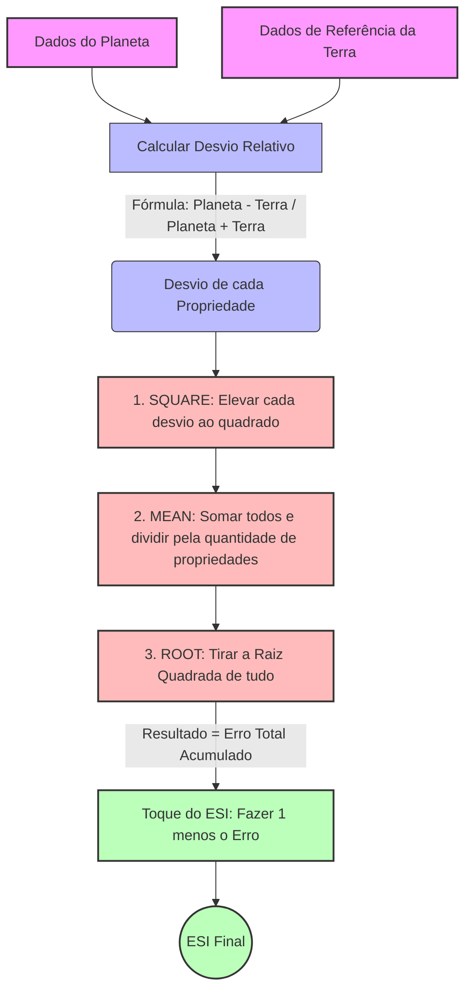
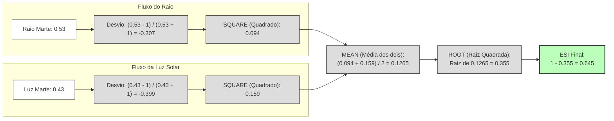
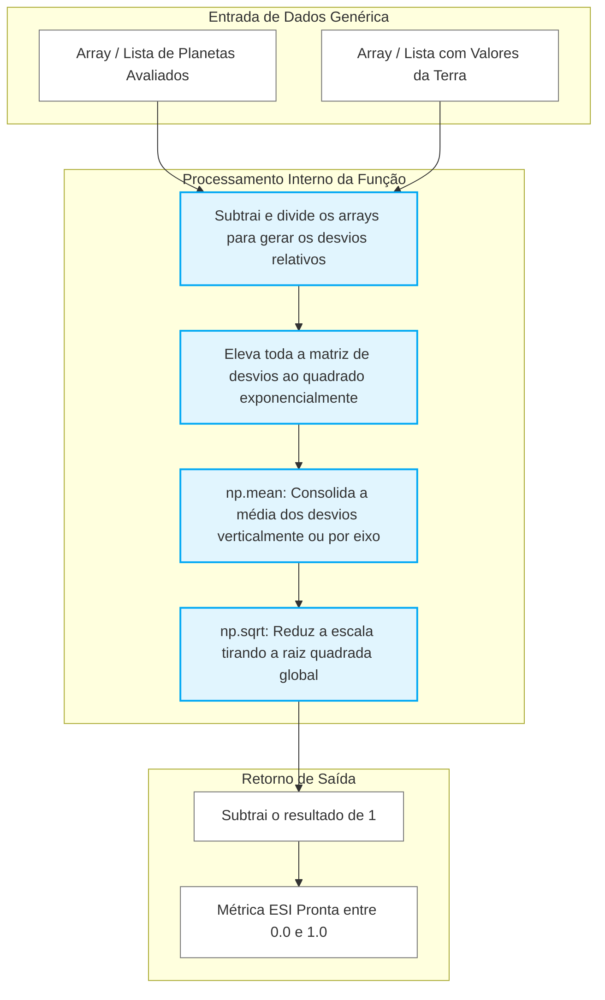

# Projeto de projeto algoritmos

## O que precisa ser feito:

- Usaremos o dataset:
  - hwc.csv
    - Não está 100% tratado
    - tem valores que não vamos precisar
    - tem uma excelente documentação
    - existe a versão dele JÁ TRATADA
    - os dados estão simples de serem resolvidos
    - 
    - ~~https://www.kaggle.com/datasets/vrushabhsonawane1/exoplanets-dataset?resource=download~~
  - ~~ou~~
    - ~~https://www.kaggle.com/datasets/walididbennacer/exohabx-habitable-exoplanets-dataset-nasa-hwc (<--- Usando)~~
- ~~Provavelmente usaremos o algoritmo de Machine Learning Gaussian Mixture Models~~
- Usaremos o K-Means com graficos e o K-means mesmo aplicando o ESI (valor gerado pela gente com base na distancia do planeta ao proprio SOL e o valor do RAIO dele) junto da distancia do planeta ao nosso SOL como uma referencia a gente para que possamos medir se é possivel irmos até ele.
- 

## TODOs:

- [ ] ...

## Infos, links e fontes:

- ESI:
# Guia Visual do ESI (Earth Similarity Index) via Média Quadrática

Este guia utiliza diagramas de fluxo para explicar a lógica matemática e o código por trás do Índice de Similaridade com a Terra (ESI).

---

## 1. A Lógica da Fórmula Geral (Lendo o RMS de trás para frente: S ➔ M ➔ R)

Em vez de ler fórmulas com símbolos matemáticos, este diagrama mostra exatamente como os dados fluem através da estrutura **RMS** (Square, Mean, Root) alterada para o ESI.

---

## 2. Exemplo Prático de Fluxo: Calculando Marte

Este mapa mental numérico simula o passo a passo exato do cálculo usando o Raio e o Fluxo Estelar de Marte.

---

## 3. Arquitetura do Código Genérico (Python / NumPy / Pandas)

Este diagrama representa visualmente o que as funções de código fazem nos bastidores, eliminando a necessidade de ler linhas puras de código para entender a lógica de processamento vetorial.

- Fonte:
  - Dados: https://phl.upr.edu/home
  - Calculo matemático usado no ESI: 
    - 
  - Calculo de parsecs em anos luz: anos-luz​=S_DISTANCE×3,26156
    - O S_DISTANCE se trata da distancia do Sol do planeta até o nosso planeta Terra, então se trata de uma aproximação
- Os alunos devem fazer:
  - Apresentar insights iniciais
  - Mostrar estatísticas básicas
  - Identificar valores nulos
  - Apresentar com gráficos
- Insights:
  - Quais são os planetas que seria possivel irmos lá descobrir se HÁ vida ou se é possivel HABITAR vida (semelhante a nossa) lá
    - Primeiro eliminamos os planetas que não tem dados o suficiente (P_RADIUS e P_FLUX)
    - Pra isso calculamos o ESI deles
  - Mas e ai as IA's vão acabar com o planeta? Gastando nossa água, esquentando nosso planeta, acabando com nossos recursos? Então cabe a gente resolver isso, como? Com IA's que desperdiçam menos energia? Com uso mais responsavel das IAs? Com pensamentos mais sustentaveis? NÃO!! NUNCA!! MAS SIM ESCOLHENDO OUTRO PLANETA... Já fud&#øs o nosso, melhor escolher outro mesmo. E foi com essa ideia que pensamos, quais seriam bons planetas para a gente morar quando tudo isso aquifor pras cucuias?
  Nas nossas pesquisas trouxemos o indice ESI (Earth Similarity Index ou Indice de Similaridade com a Terra), usado como um indice superficial pela Universidade de Porto Rico com esse dataset para inicialmente identificar planetas que conseguiriam ter o minimo de similaridade com a Terra, pois é a premissa de mantermos uma vida baseada em carbono (que é a nossa). Depois disso veio a pergunta "Mas da pra chegar com o meu BYD Dolphin Hybrid com 1000km de autonomia?" e para o desespero meu (e do Han Solo e já explico o porquê) não dá. Acontece que estamos muitos anos luz (ly) de distancia, que originalmente estão registrados em parsecs ou pc (viu Han Solo, não é medida de tempo e sim de distancia, mentiroso salafrario). 

## Notas e Rascunhos:

...
