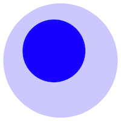

# \_library

Second Brain pessoal em **Foam** (VS Code + Markdown + grafo de notas), organizado como
Zettelkasten para transformar ideias e aulas em conhecimento reutilizável.

## Manifesto

Ideias surgem a qualquer hora e, se não forem capturadas, somem. Este vault existe pra capturar,
destilar e reusar — o papel que Google + histórico de navegador tinham antes, agora com material
próprio, resumido e com exemplos, pra só reforçar o conhecimento quando ele falhar na memória.

Texto completo em [[000-sobre-library]].

## Como funciona (Second Brain)

- **Capture:** [[inbox]] e dailies em `journals/daily/` — escreveu, não julgou
- **Organize (PARA):** [[000-index]] é o MOC; `aulas/` = Areas (disciplinas), `notes/` = Resources evergreen,
  `docs/esp32/` + `docs/livros/` = Resources de referência, `journals/arquivo/` + `docs/_foam-upstream/` = Archive
- **Distill:** aula em `aulas/` → nota evergreen em `notes/` (Johnny Decimal `000-400`)
- **Express:** [[todo]] + grafo Foam (`Foam: Show Graph`) + esta home

## Mapa rápido

- Entrada evergreen: [[000-index]]
- Captura: [[inbox]] · Tarefas: [[todo]]
- Aulas: `aulas/` · Dailies: `journals/daily/` · Journals: `journals/`
- Referência Foam arquivada: `docs/_foam-upstream/getting-started.md`

## Convenções

- Wiki links Foam: colchetes duplos com o stem da nota, `#Heading` pra heading, `|Alias` pra alias (ex: nota-linkada com alias de exibição)
- Evergreen: uma nota por tema em `notes/NNN-slug.md`, linkada no [[000-index]]
- Aula: `aulas/<disciplina>/aula <tema> - DD-MM-YYYY.md` (nome gerado pelo template)
